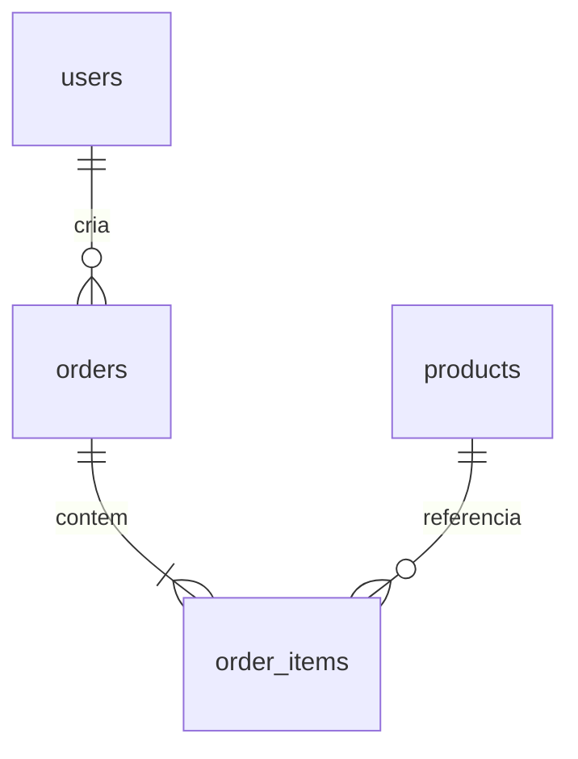

# Relatório de Banco de Dados

> Escopo: inspeção somente leitura do código e de `backend/pao.db`, em 2026-10-22. O relatório não contém valores de credenciais, tokens, URLs de conexão, hashes nem dados pessoais. Cada conclusão está marcada como **FATO**, **INFERÊNCIA** ou **NÃO VERIFICADO**.
>
> Atualização em 2026-10-27: a aplicação agora exige `DATABASE_URL` ou `SUPABASE_DB_URL` com PostgreSQL hospedado em domínio oficial do Supabase em todos os ambientes de execução; SQLite só é permitido nos testes. As descrições de fallback e estado do workspace abaixo são um retrato histórico da inspeção de 2026-10-22, não a política atual.

## Índice

1. [Visão geral do sistema](#1-visão-geral-do-sistema)
2. [Esquema atual](#2-esquema-atual)
3. [Mapa de acesso a dados](#3-mapa-de-acesso-a-dados-endpoint-por-endpoint)
4. [Regras de negócio](#4-regras-de-negócio-que-o-banco-precisa-garantir)
5. [Dados usados pelo frontend](#5-dados-usados-pelo-frontend)
6. [Dados reais](#6-dados-reais)
7. [Problemas e riscos](#7-problemas-e-riscos-encontrados)
8. [Requisitos que ainda não existem](#8-requisitos-que-ainda-não-existem)
9. [Volume e desempenho](#9-volume-e-desempenho-esperados)
10. [Perguntas em aberto](#10-perguntas-em-aberto)
11. [Anexos](#11-anexos)

## 1. Visão geral do sistema

- **FATO** — O projeto implementa uma loja online de padaria: o frontend apresenta catálogo e carrinho; a API oferece cadastro, autenticação, produtos e pedidos. O backend FastAPI também serve o HTML por meio de Flask/WSGI (`frontend/undex.html:1`, `backend/main.py:9-12`, `backend/main.py:373-382`).
- **FATO** — Os atores de aplicação são clientes, cujo papel padrão é `user`, e administradores com papel `admin`. O backend deriva o acesso administrativo do papel persistido em `users.role` (`backend/main.py:56-65`, `backend/main.py:240-277`).
- **FATO** — Fluxo: cadastro/login cria ou autentica `users`; a página carrega `products`; o navegador mantém o carrinho; checkout envia endereço, observações e itens; o backend grava `orders` e `order_items`; admin lista todos os pedidos e atualiza status; cliente autenticado lista somente os próprios pedidos (`backend/main.py:403-428`, `backend/main.py:480-510`, `backend/main.py:521-562`, `frontend/undex.html:1958-1971`, `frontend/undex.html:2985-3025`).
- **FATO** — A API escolhe SQLite se `DATABASE_URL` estiver vazia em desenvolvimento; em produção sem ela, interrompe a inicialização. URLs PostgreSQL são adaptadas ao driver `psycopg` (`backend/main.py:21-31`).
- **FATO** — Neste workspace há `backend/pao.db`, consultado em modo somente leitura; o módulo SQLite usado nesta consulta reportou versão 3.45.1. O arquivo contém as quatro tabelas deste relatório. A aplicação também suporta PostgreSQL via `psycopg` (`backend/pao.db`, consulta SELECT em 2026-10-22; `backend/main.py:21-47`; `backend/requirements.txt:1-8`).
- **FATO** — A configuração Render declara `DATABASE_URL` como variável externa e configura execução Python no diretório `backend` (`render.yaml:1-14`).
- **NÃO VERIFICADO** — Não foi possível confirmar se existe um PostgreSQL/Supabase remoto ativo, sua versão ou se o serviço Render já está publicado: não havia variável de conexão no ambiente de inspeção nem arquivo local `.env`. Para confirmar, seria necessário acesso autorizado à configuração do Render/Supabase; uma eventual consulta remota deve ser somente `SELECT`.
- **FATO** — O nome da variável realmente consumida pela aplicação é `DATABASE_URL`; `SUPABASE_URL`, `SUPABASE_PUBLISHABLE_KEY` e `SUPABASE_SECRET_KEY` aparecem no exemplo de ambiente, mas não são lidas por `backend/main.py` (`backend/main.py:21-31`; `backend/.env.example:1-7`).

## 2. Esquema atual

### 2.1 Tabelas e colunas

**FATO — `users`** (`backend/main.py:56-65`; DDL local: `backend/pao.db`, consulta SELECT em 2026-10-22)

| Coluna | Tipo atual no SQLite | Nulo? | Default SQLAlchemy | PK/FK/constraint |
|---|---|---:|---|---|
| `id` | INTEGER | Não | geração automática da PK | PK |
| `name` | VARCHAR(120) | Não | nenhum | — |
| `email` | VARCHAR(180) | Não | nenhum | UNIQUE; índice único `ix_users_email` |
| `password_hash` | VARCHAR(255) | Não | nenhum | — |
| `role` | VARCHAR(20) | Não | `user` no ORM | sem CHECK de domínio |
| `created_at` | DATETIME | Não | função Python com UTC | sem default no DDL SQLite |

**FATO — `products`** (`backend/main.py:68-78`; `backend/main.py:165-180`; DDL local: `backend/pao.db`, consulta SELECT em 2026-10-22)

| Coluna | Tipo atual no SQLite | Nulo? | Default SQLAlchemy | PK/FK/constraint |
|---|---|---:|---|---|
| `id` | INTEGER | Não | geração automática da PK | PK |
| `name` | VARCHAR(150) | Não | nenhum | — |
| `description` | VARCHAR(500) | Não | string vazia no ORM | — |
| `price` | NUMERIC(10,2) | Não | nenhum | sem CHECK no ORM/SQLite |
| `category` | VARCHAR(80) | Não | `Outros` no ORM | — |
| `image` | VARCHAR(500) | Não | string vazia no ORM | — |
| `promo` | JSON | Sim | `None`/nulo permitido | sem constraint de estrutura JSON |
| `active` | BOOLEAN | Não | `true` no ORM | — |

**FATO — `orders`** (`backend/main.py:81-96`; DDL local: `backend/pao.db`, consulta SELECT em 2026-10-22)

| Coluna | Tipo atual no SQLite | Nulo? | Default SQLAlchemy | PK/FK/constraint |
|---|---|---:|---|---|
| `id` | INTEGER | Não | geração automática da PK | PK |
| `user_id` | INTEGER | Não | nenhum | FK para `users.id`; sem `ON DELETE` no modelo/SQLite |
| `address` | VARCHAR(300) | Não | nenhum | — |
| `notes` | VARCHAR(500) | Não | string vazia no ORM | — |
| `status` | VARCHAR(30) | Não | `pendente` no ORM | sem CHECK no ORM/SQLite |
| `total` | NUMERIC(10,2) | Não | zero no ORM | sem CHECK no ORM/SQLite |
| `created_at` | DATETIME | Não | função Python com UTC | sem default no DDL SQLite |

**FATO — `order_items`** (`backend/main.py:99-108`; DDL local: `backend/pao.db`, consulta SELECT em 2026-10-22)

| Coluna | Tipo atual no SQLite | Nulo? | Default SQLAlchemy | PK/FK/constraint |
|---|---|---:|---|---|
| `id` | INTEGER | Não | geração automática da PK | PK |
| `order_id` | INTEGER | Não | nenhum | FK para `orders.id`; sem `ON DELETE` no modelo/SQLite |
| `product_id` | INTEGER | Não | nenhum | FK para `products.id`; sem `ON DELETE` |
| `name` | VARCHAR(150) | Não | nenhum | — |
| `price` | NUMERIC(10,2) | Não | nenhum | sem CHECK no ORM/SQLite |
| `quantity` | INTEGER | Não | nenhum | sem CHECK no ORM/SQLite |

- **FATO** — O ORM declara `Order.items` com cascata ORM `all, delete-orphan`; isso não equivale a uma constraint `ON DELETE CASCADE` no banco. `Order.user` e `Order.items` são relacionamentos ORM (`backend/main.py:91-92`).
- **FATO** — O arquivo `backend/migration_initial.sql` declara `CHECK (price >= 0)` em `products`, `CHECK (total >= 0)` em `orders`, `CHECK (price >= 0)` e `CHECK (quantity > 0)` em `order_items`. Também declara `ON DELETE CASCADE` somente em `order_items.order_id`; não declara CHECK para `role` ou `status` (`backend/migration_initial.sql:13-40`).
- **FATO** — Na migration, `users.created_at` e `orders.created_at` são `TIMESTAMPTZ DEFAULT NOW()`; os modelos usam `DateTime` sem `timezone=True`, com default executado em Python (`backend/migration_initial.sql:4-10`, `backend/migration_initial.sql:24-31`, `backend/main.py:63`, `backend/main.py:90`).
- **FATO** — A migration usa `JSONB` para `products.promo`; o modelo SQLAlchemy declara `JSON`. O SQLite local tem coluna `JSON` (`backend/migration_initial.sql:13-21`, `backend/main.py:77`, DDL de `backend/pao.db`, consulta SELECT em 2026-10-22).
- **FATO** — `backend/database.sql` não foi encontrado no snapshot do repositório. A única migration localizada é `backend/migration_initial.sql`.

### 2.2 Relacionamentos



- **FATO** — Cada pedido aponta para um usuário; cada item aponta para um pedido e um produto. As FKs e o relacionamento ORM estão declarados no modelo (`backend/main.py:84-108`).
- **INFERÊNCIA** — Recomenda-se preservar `order_items.name` e `order_items.price` como snapshot histórico, mantendo `product_id` opcional ou com política explícita de retenção; hoje o item guarda nome e preço, mas a FK de produto impede apagar fisicamente o produto em um banco com FKs efetivamente aplicadas (`backend/main.py:99-108`; `backend/migration_initial.sql:34-40`).

### 2.3 Comparação das três fontes

| Aspecto | SQLAlchemy (`backend/main.py`) | Migration | Banco local SQLite | Resultado |
|---|---|---|---|---|
| PKs | PK `Integer`; geração pelo ORM | `INTEGER ... AS IDENTITY` | `INTEGER PRIMARY KEY` | **FATO:** representação varia por dialeto; compatível como identificador inteiro. (`backend/main.py:58`, `backend/main.py:71`, `backend/main.py:84`, `backend/main.py:102`; migration linhas 5, 14, 25, 35) |
| Defaults de texto e booleano | Defaults Python/ORM em descrição, categoria, imagem, role, status, total e active | Defaults SQL no banco | Sem defaults server-side no DDL local | **FATO:** insert SQL direto não recebe necessariamente os defaults Python; fontes divergem. (`backend/main.py:62`, `backend/main.py:73-78`, `backend/main.py:87-90`; `backend/migration_initial.sql:9`, `backend/migration_initial.sql:16-21`, `backend/migration_initial.sql:28-31`) |
| Datas | `DateTime` sem timezone e callable UTC | `TIMESTAMPTZ DEFAULT NOW()` | `DATETIME`, sem default | **FATO:** divergência de tipo, fuso e origem do default. (`backend/main.py:63`, `backend/main.py:90`; `backend/migration_initial.sql:10`, `backend/migration_initial.sql:31`) |
| Promoção | `JSON` | `JSONB` | `JSON` | **FATO:** tipo PostgreSQL diverge. (`backend/main.py:77`; `backend/migration_initial.sql:20`) |
| Checks monetários | Nenhum no metadata | preço e total não negativos | Nenhum no DDL local | **FATO:** a migration é mais restritiva. (`backend/main.py:74`, `backend/main.py:89`; `backend/migration_initial.sql:17`, `backend/migration_initial.sql:30`) |
| Quantidade | `Integer`, sem CHECK no modelo | `CHECK (quantity > 0)` | Sem CHECK | **FATO:** só a migration protege essa regra no banco. (`backend/main.py:107`; `backend/migration_initial.sql:40`) |
| Status e papel | `String`, sem CHECK | `String`, sem CHECK | `String`, sem CHECK | **FATO:** nenhuma fonte restringe domínio no banco. (`backend/main.py:62`, `backend/main.py:88`; `backend/migration_initial.sql:9`, `backend/migration_initial.sql:29`) |
| Email | `unique=True, index=True` | `UNIQUE(email)` e índice adicional `ix_users_email` | índice único `ix_users_email` | **FATO:** migration cria índice não único redundante em relação ao índice de UNIQUE. (`backend/main.py:60`; `backend/migration_initial.sql:7`, `backend/migration_initial.sql:43`; `backend/pao.db`, consulta SELECT) |
| Índices em FKs | Não declarados para `orders.user_id` ou FKs de `order_items` | `orders.user_id`, `order_items.order_id` | Nenhum desses índices no DDL local | **FATO:** divergência de indexação entre migration e ORM/SQLite. (`backend/main.py:85`, `backend/main.py:103-104`; `backend/migration_initial.sql:44-45`; `backend/pao.db`, consulta SELECT) |
| Delete em FK de item | Cascata somente no ORM `Order.items` | `order_items.order_id ON DELETE CASCADE` | Sem `ON DELETE` | **FATO:** divergência de comportamento ORM/banco. (`backend/main.py:92`, `backend/main.py:103-104`; `backend/migration_initial.sql:36-37`; DDL local) |
| Outros deletes em FK | Nenhum `ondelete` | Sem cascade nas FKs user/product | Sem cascade | **FATO:** exclusão física não tem política uniforme. (`backend/main.py:85`, `backend/main.py:103-104`; `backend/migration_initial.sql:26`, `backend/migration_initial.sql:37`) |

- **FATO** — A migration contém `CREATE TABLE IF NOT EXISTS`; ela não altera automaticamente uma tabela já criada com outra definição. O startup usa `Base.metadata.create_all(engine)`, que também não substitui um sistema de migrações (`backend/migration_initial.sql:4`, `backend/main.py:279-280`).

## 3. Mapa de acesso a dados: endpoint por endpoint

**FATO** — `get_db` abre uma sessão SQLAlchemy por request e a fecha no `finally` (`backend/main.py:177-184`). Nos itens abaixo, “commit” indica commit explícito no endpoint; leituras podem abrir transação implícita do SQLAlchemy, mas não fazem commit explícito.

| Método e rota | Quem pode chamar | Tabelas lidas/escritas | Operação e transação |
|---|---|---|---|
| `GET /` e `GET /undex.html`; `GET /{requested_path}` | Público | Nenhuma | Serve arquivos frontend; sem sessão/commit (`backend/main.py:373-382`). |
| `GET /health` | Público | Nenhuma | Saúde da aplicação; sem commit (`backend/main.py:389-391`). |
| `GET /health/db` | Público | Nenhuma tabela; `SELECT 1` | Verifica conexão; sem commit (`backend/main.py:394-400`). |
| `POST /auth/register` | Público | Lê e escreve `users` | Verifica e-mail, adiciona usuário, commit, refresh. Captura `IntegrityError`, rollback e retorna 409 (`backend/main.py:403-418`). |
| `POST /auth/login` | Público | Lê `users` | Verifica senha e emite cookie/token; sem escrita/commit (`backend/main.py:421-428`). |
| `GET /auth/demo-accounts` | Público, mas dados de demo só no ambiente permitido | Lê `users` se demo estiver habilitado | Somente leitura; sem commit (`backend/main.py:431-442`). |
| `POST /auth/demo-login` | Público somente em demo habilitado | Lê `users` | Autentica conta demo; sem escrita/commit (`backend/main.py:444-454`). |
| `GET /auth/me` | Autenticado | Lê `users` | Resolve usuário do token/cookie; sem commit (`backend/main.py:240-277`, `backend/main.py:457-459`). |
| `POST /auth/session` | Autenticado | Lê `users` | Renova cookie; sem escrita/commit (`backend/main.py:462-465`). |
| `POST /auth/logout` | Público | Nenhuma | Limpa cookie; sem banco/commit (`backend/main.py:468-477`). |
| `GET /products` | Público | Lê `products` | Lista ativos em ordem de id; sem paginação/commit (`backend/main.py:480-483`). |
| `GET /products/admin` | Admin | Lê `products` | Lista todos, inclusive inativos; sem paginação/commit (`backend/main.py:485-488`). |
| `POST /products` | Admin | Escreve `products` | Insere produto, commit e refresh; não captura `IntegrityError` (`backend/main.py:490-496`). |
| `PATCH /products/{product_id}` | Admin | Lê e atualiza `products` | Commit e refresh; não captura `IntegrityError` (`backend/main.py:499-509`). |
| `DELETE /products/{product_id}` | Admin | Atualiza `products` | Exclusão lógica (`active=false`), commit; não captura `IntegrityError` (`backend/main.py:511-518`). |
| `POST /orders` | Cliente autenticado | Lê `users` pela dependência e `products`; escreve `orders`, `order_items` | Calcula preços/totais, insere pedido e itens numa sessão, commit e refresh. Sem catch explícito de `IntegrityError` (`backend/main.py:521-562`). |
| `GET /orders` | Autenticado; admin vê todos, cliente vê os próprios | Lê `orders`, `users` e `order_items` via relacionamentos | Sem paginação/commit; serialização pode disparar consultas lazy (`backend/main.py:565-571`, `backend/main.py:91-96`, `backend/main.py:201-212`). |
| `PATCH /orders/{order_id}/status` | Admin | Lê e atualiza `orders` | Valida apenas se o valor está numa lista, commit e refresh; sem transição permitida por estado e sem catch de `IntegrityError` (`backend/main.py:573-585`). |
| `POST /orders/{order_id}/cancel` | Cliente autenticado, dono do pedido | Lê e atualiza `orders` | Só cancela estado pendente; commit e refresh. Sem lock/atualização condicional e sem catch de `IntegrityError` (`backend/main.py:587-597`). |

- **FATO** — Só o cadastro captura `IntegrityError` explicitamente; os outros endpoints que fazem commit não implementam rollback/erro de integridade local (`backend/main.py:403-418`, `backend/main.py:490-518`, `backend/main.py:521-597`).
- **FATO** — Não há paginação nos endpoints de catálogo ou pedidos; `GET /orders` retorna toda a consulta aplicável (`backend/main.py:480-488`, `backend/main.py:565-571`).
- **INFERÊNCIA** — Há risco de N+1 em `GET /orders`: `Order.items` e `Order.user` usam o carregamento lazy padrão; o response acessa `items` e a propriedade `user_email`, que acessa `user.email`. Um pedido com muitos registros pode gerar consultas adicionais por pedido (`backend/main.py:91-96`, `backend/main.py:99-108`, `backend/main.py:201-212`).
- **FATO** — `orders.user_id` é filtro frequente de cliente; `products.active` filtra catálogo; o SQLAlchemy não declara índices para esses filtros, exceto o índice de email. A migration adiciona índice para `orders.user_id`, mas não para `products.active` ou `orders.status` (`backend/main.py:60`, `backend/main.py:480-483`, `backend/main.py:565-571`; `backend/migration_initial.sql:43-45`).
- **FATO** — `order_items.order_id` e `product_id` são FKs no modelo; somente a migration indexa `order_items.order_id`, não `product_id` (`backend/main.py:103-104`; `backend/migration_initial.sql:45`).

## 4. Regras de negócio que o banco precisa garantir

| Regra | Onde está hoje | O que o banco garante hoje |
|---|---|---|
| Preço e total | **FATO:** API calcula preço promocional e total no checkout usando `Decimal`; Pydantic/modelos usam `float` em tipos de preço/resposta (`backend/main.py:165-180`, `backend/main.py:521-561`, `backend/main.py:201-212`). | **FATO:** `NUMERIC(10,2)`; no ORM/SQLite não há CHECK de não negativo. A migration inclui checks em preço/total (`backend/main.py:74`, `backend/main.py:89`; `backend/migration_initial.sql:17`, `backend/migration_initial.sql:30`). |
| Promoção | **FATO:** API entende `active`, `type` (`percent` ou `fixed`) e `value`; percentuais acima de 100 ou valores negativos são rejeitados no cálculo (`backend/main.py:521-545`). | **FATO:** coluna JSON/JSONB sem check de estrutura ou limite (`backend/main.py:77`; `backend/migration_initial.sql:20`). |
| Status permitido | **FATO:** endpoint aceita `pendente`, `preparando`, `saiu_entrega`, `entregue`, `cancelado` (`backend/main.py:575-577`). | **FATO:** sem CHECK na migration e modelo; estado arbitrário pode ser inserido por SQL direto (`backend/main.py:88`, `backend/main.py:214`; `backend/migration_initial.sql:29`). |
| Transições de status | **FATO:** admin pode escolher qualquer status permitido, independentemente do status anterior (`backend/main.py:573-585`; `frontend/undex.html:2722-2730`). | **FATO:** não há tabela de transições nem histórico de status. |
| Cancelamento | **FATO:** cliente só cancela seu próprio pedido quando está `pendente` (`backend/main.py:587-597`). | **FATO:** regra está na aplicação, sem constraint no banco. |
| Produto indisponível | **FATO:** `DELETE /products/{id}` define `active=false`; checkout exige produto ativo (`backend/main.py:511-518`, `backend/main.py:521-528`). | **FATO:** `active BOOLEAN`; não há `deleted_at` nem auditoria de mudança (`backend/main.py:78`). |
| E-mail | **FATO:** cadastro/login removem espaços externos e convertem para minúsculas; email tem UNIQUE (`backend/main.py:124-143`, `backend/main.py:60`, `backend/main.py:403-418`). | **FATO:** UNIQUE diferencia maiúsculas/minúsculas conforme configuração/collation do banco; não há índice explícito em `lower(email)` na migration. |
| Quantidade | **FATO:** cada item da API limita quantidade a 1–99 (`backend/main.py:181-184`). | **FATO:** migration exige `quantity > 0`; SQLite local e modelo não têm CHECK nem limite máximo (`backend/main.py:107`, `backend/migration_initial.sql:40`). |
| Snapshot do item | **FATO:** `order_items` grava nome e preço do produto no pedido (`backend/main.py:548-559`, `backend/main.py:99-108`). | **FATO:** preserva nome/preço do item, mas não registra preço original, promoção aplicada, SKU ou custo. |
| Papéis | **FATO:** `admin_user` exige papel `admin`; cadastro comum instancia `User` com papel padrão `user`; bootstrap permite admin controlado por ambiente (`backend/main.py:62`, `backend/main.py:272-277`, `backend/main.py:310-329`). | **FATO:** coluna `VARCHAR(20)` sem CHECK/enum (`backend/main.py:62`; `backend/migration_initial.sql:9`). |
| Linhas repetidas do mesmo produto | **INFERÊNCIA:** `OrderCreate.items` não declara que `product_id` deve ser único; o backend cria um `OrderItem` para cada entrada, então duplicatas podem resultar em várias linhas no mesmo pedido (`backend/main.py:181-189`, `backend/main.py:522-560`). | **FATO:** não há constraint `UNIQUE(order_id, product_id)`. |

## 5. Dados usados pelo frontend

### 5.1 Campos enviados e lidos

- **FATO — Usuário:** cadastro envia `name`, `email`, `password`; login envia `email`, `password`; a tela lê `id`, `name`, `email`, `role`. O response de usuário não inclui senha/hash (`frontend/undex.html:2860-2905`; `backend/main.py:111-157`).
- **FATO — Produto:** a API entrega `id`, `name`, `description`, `price`, `category`, `image`, `promo`, `active`; cadastro/edição envia esses campos, sem `id` no payload de criação (`backend/main.py:165-180`; `frontend/undex.html:2740-2765`).
- **FATO — Pedido:** checkout envia `address`, `notes`, `items[{product_id, quantity}]`. A tela usa `id`, `user_email`, `address`, `notes`, `status`, `total`, `created_at`, `items[{product_id, name, price, quantity}]` (`frontend/undex.html:3010-3023`; `backend/main.py:186-212`).
- **FATO** — O frontend cria aliases `createdAt`, `userId`, `userEmail`, `qty` e `id` do item para consumo visual. `OrderResponse` não expõe `user_id`, então o alias `userId` fica sem valor (`frontend/undex.html:1962-1971`; `backend/main.py:201-212`).
- **FATO** — `PRODUCTS_SEED` tem 21 produtos; seus objetos incluem `featured` e/ou `isNew`, campos que não existem em `Product` nem `ProductResponse`. Após carregar do backend, esses marcadores não são garantidos (`frontend/undex.html:1610-1818`, `frontend/undex.html:2695-2704`; `backend/main.py:68-78`, `backend/main.py:165-180`).
- **FATO** — `IMAGE_CATALOG` contém metadados de imagem (`imageSource`, licença, URL da licença, crédito e nota) ausentes da tabela `products`; `applyVerifiedImageCatalog` grava uma cópia local, mas a busca do arquivo não encontrou chamada para essa função (`frontend/undex.html:2036-2240`, `frontend/undex.html:2285-2345`; `backend/main.py:68-78`).
- **FATO** — O catálogo do frontend e o seed de backend têm 21 produtos e coincidem em id, nome, preço e categoria na comparação com `backend/pao.db`; as imagens do mapa frontend são uma fonte distinta do campo simples `products.image` usado pelo backend (`frontend/undex.html:1610-1818`, `frontend/undex.html:2036-2240`; `backend/main.py:336-379`; `backend/pao.db`, consulta SELECT em 2026-10-22).

### 5.2 Persistência no navegador

O wrapper acrescenta o prefixo `pao_v2_` às chaves do navegador (`frontend/undex.html:1586-1606`).

| Chave final | Formato/uso observado |
|---|---|
| `pao_v2_cart` | **FATO:** array JSON de `{product, qty}`; `product` é cópia dos dados do produto, `qty` é limitado a 1–99 no wrapper (`frontend/undex.html:1857-1869`, `frontend/undex.html:1878-1889`). |
| `pao_v2_address` | **FATO:** string com o endereço único salvo no navegador e reutilizado no checkout (`frontend/undex.html:1870-1872`, `frontend/undex.html:2973`, `frontend/undex.html:3024`). |
| `pao_v2_products` | **FATO:** a função de atualização de imagens lê/grava array local de produtos; não é fonte persistente do backend e a função não tem chamada localizada (`frontend/undex.html:2285-2344`). |
| `pao_v2_imageCatalogVersion` | **FATO:** string de versão do catálogo de imagens, lida/grava pela mesma função (`frontend/undex.html:2294`, `frontend/undex.html:2345`). |
| `pao_v2_session` | **FATO:** o código ainda tenta ler e remove essa chave, mas não há `DB.set("session", ...)` no arquivo; a sessão ativa vem da API/cookie (`frontend/undex.html:1849-1855`, `frontend/undex.html:1875`, `frontend/undex.html:1947`). |

### 5.3 Recursos que dependem de dados ainda não modelados

- **FATO** — O frontend exibe timeline com base no status atual, não numa tabela de eventos; não há histórico de mudanças (`frontend/undex.html:2510-2545`; esquema `backend/migration_initial.sql:4-45`).
- **FATO** — Endereço salvo é uma string única no navegador; endereço do pedido é armazenado em `orders.address`; não existe tabela de endereços (`frontend/undex.html:1870-1872`, `frontend/undex.html:2973-3024`; `backend/main.py:86`).
- **FATO** — Existe aviso visual de novo pedido no painel e polling em intervalos; não existe tabela de notificação, fila, e-mail ou push (`frontend/undex.html:1810-1828`, `frontend/undex.html:2635-2662`; schema `backend/migration_initial.sql:4-45`).
- **FATO** — Não há entidade de estoque, pagamento, cupom, filial, taxa de entrega ou preço histórico no esquema (`backend/main.py:56-108`; `backend/migration_initial.sql:4-45`).
- **FATO** — O painel calcula contagens por status e soma de totais carregados, mas não há relatório histórico/agrupado por data ou produto (`frontend/undex.html:2618-2635`, `frontend/undex.html:2522-2528`).

## 6. Dados reais (banco local)

**FATO** — `backend/pao.db` foi aberto com URI SQLite `mode=ro`; as consultas foram agregadas e não retornaram valores pessoais. O banco remoto não foi acessado (`backend/pao.db`, consultas SELECT em 2026-10-22).

| Tabela | Linhas e qualidade observada |
|---|---|
| `users` | **FATO:** 2 linhas; papéis: 1 `admin`, 1 `user`; nenhum nome/e-mail vazio; nenhuma duplicidade por `lower(trim(email))`; datas entre 2026-10-21 e 2026-10-21. Nenhum valor pessoal é exibido. |
| `products` | **FATO:** 21 linhas; categorias: Bebidas 4, Doces 7, Pães 6, Salgados 4; preço mínimo 0,75 e máximo 18,90; zero preço zero, nomes vazios ou imagens vazias. Os 21 itens coincidem com o seed em id/nome/preço/categoria. |
| `orders` | **FATO:** 0 linhas; sem intervalo de datas ou status observados; não há órfãos nesta amostra vazia. |
| `order_items` | **FATO:** 0 linhas; sem quantidades/preços inválidos ou órfãos nesta amostra vazia. |

- **NÃO VERIFICADO** — Se as URLs de imagens respondem HTTP: isso exigiria requisições externas `HEAD`/`GET`; a consulta ao banco só verificou ausência de URL vazia (`backend/pao.db`, consulta SELECT em 2026-10-22).
- **NÃO VERIFICADO** — Contagens, status, papéis, órfãos e qualidade do banco Supabase remoto; exige conexão autorizada e consultas SELECT apenas.

## 7. Problemas e riscos encontrados

| Gravidade | Classificação e evidência | Impacto | Correção sugerida |
|---|---|---|---|
| Alta | **FATO:** `status` e `role` são strings sem CHECK no modelo nem na migration (`backend/main.py:62`, `backend/main.py:88`; `backend/migration_initial.sql:9`, `backend/migration_initial.sql:29`). | Inserts SQL/bugs podem persistir domínio inválido. | Adicionar CHECK/enum versionado e manter validação da API. |
| Alta | **FATO:** valores monetários `Numeric(10,2)` são anotados como `float` em ORM/Pydantic (`backend/main.py:74`, `backend/main.py:89`, `backend/main.py:106`, `backend/main.py:168`, `backend/main.py:205`). | Conversões binárias podem introduzir diferenças em cálculos/serialização. | Usar `Decimal` de ponta a ponta e testar arredondamento/escala. |
| Alta | **FATO:** migration e modelo/SQLite divergem em CHECKs, defaults, tipos JSON, fuso horário, índices e cascade (`backend/main.py:56-108`; `backend/migration_initial.sql:4-45`; `backend/pao.db`, DDL SELECT). | Comportamento pode mudar conforme banco criado por migration ou por `create_all`. | Escolher uma fonte de schema e aplicar migrations versionadas, com migração de dados existente. |
| Alta | **FATO:** startup usa `Base.metadata.create_all()` e não há Alembic listado nas dependências (`backend/main.py:279-280`, `backend/main.py:384-387`; `backend/requirements.txt:1-8`). | `create_all` não altera schema existente e mudanças futuras podem ficar incompletas. | Adotar Alembic e bloquear alterações de schema implícitas em produção. |
| Alta | **INFERÊNCIA:** cancelar e alterar status são operações “ler estado, depois gravar” sem bloqueio ou condição no UPDATE (`backend/main.py:573-597`). | Corrida entre cancelamento pelo cliente e atualização do admin pode aceitar ambos com resultado dependente da ordem. | Atualização condicional/optimistic locking e máquina de estados transacional. |
| Média | **FATO:** endpoint valida valores de status, mas não transições entre estados (`backend/main.py:573-585`). | Pedido pode saltar de pendente direto para entregue ou voltar de entregue para pendente. | Definir transições permitidas em serviço e validar no banco quando apropriado. |
| Média | **FATO:** modelos não definem índices para `orders.user_id`, `order_items.order_id` e `order_items.product_id`; só migration indexa os dois primeiros (`backend/main.py:85`, `backend/main.py:103-104`; `backend/migration_initial.sql:43-45`). | Filtragem e carregamento de itens podem ficar mais caros; `product_id` segue sem índice na migration. | Revisar plano de consultas e indexar FKs/filtros usados. |
| Média | **INFERÊNCIA:** resposta de pedidos pode provocar N+1 por carregamento lazy de `order.items` e `order.user` (`backend/main.py:91-96`, `backend/main.py:201-212`). | Com crescimento de pedidos, aumenta número de consultas e latência. | Usar `selectinload`/joins apropriados, paginação e projeções. |
| Média | **FATO:** datas usam `DateTime` sem `timezone=True`, enquanto migration PostgreSQL usa `TIMESTAMPTZ` (`backend/main.py:63`, `backend/main.py:90`; `backend/migration_initial.sql:10`, `backend/migration_initial.sql:31`). | SQLite/PostgreSQL podem serializar e comparar timestamps com semântica diferente. | Padronizar UTC com tipos timezone-aware e testar round-trip nos dois dialetos. |
| Média | **FATO:** somente `order_items.order_id` tem cascade na migration; nenhuma FK de modelo inclui `ondelete` (`backend/main.py:85`, `backend/main.py:92`, `backend/main.py:103-104`; `backend/migration_initial.sql:26`, `backend/migration_initial.sql:36-37`). | Exclusão física pode falhar ou depender do ORM; risco de inconsistência entre caminhos. | Definir política por entidade e alinhar ORM/DDL. Preferir desativação/retenção quando há histórico. |
| Média | **NÃO VERIFICADO:** RLS Supabase, proprietário das tabelas, papéis PostgreSQL efetivos e políticas não puderam ser consultados. O app acessa PostgreSQL por SQLAlchemy/psycopg e autentica usuários na própria API (`backend/main.py:21-47`, `backend/main.py:240-277`). | Não é possível afirmar se RLS está ativa nem se protege acesso por fora da API. | Auditar políticas e privilégios no Supabase, usando acesso somente leitura; não expor a chave de serviço ao frontend. |
| Média | **NÃO VERIFICADO:** política/execução de backups do Supabase e retenção do Render não foram acessadas. O SQLite local está ignorado pelo Git (`.gitignore:1-8`). | Perda de dados pode não ser recuperável; não se deve tratar disco local de serviço efêmero como backup. | Confirmar plano, backups automáticos, retenção e teste de restauração. |
| Média | **FATO:** há `IntegrityError` tratado no cadastro, mas não há tratamento equivalente nos demais commits (`backend/main.py:403-418`, `backend/main.py:490-518`, `backend/main.py:521-597`). | Erros de integridade podem retornar 500 e deixar sessão em estado de erro até fechar. | Rollback explícito e respostas de domínio consistentes nos endpoints de escrita. |
| Média | **FATO:** `GET /products`, `/products/admin` e `/orders` não têm paginação (`backend/main.py:480-488`, `backend/main.py:565-571`). | Respostas e uso de memória crescem com catálogo/histórico. | Paginação cursor/limit, ordenação estável e limites máximos. |
| Baixa | **FATO:** migration cria `UNIQUE(email)` e depois um índice adicional `ix_users_email` (`backend/migration_initial.sql:7`, `backend/migration_initial.sql:43`). | Índice redundante usa espaço e pode aumentar custo de escrita. | Manter a constraint UNIQUE e usar o índice que ela já cria; conferir nomes reais no PostgreSQL. |
| Média | **FATO:** SQLite declara FKs no DDL, mas o código configura apenas `check_same_thread=False` e não ativa `PRAGMA foreign_keys` (`backend/main.py:39-47`; DDL local). | **INFERÊNCIA:** no SQLite, constraints FK podem não ser aplicadas pela conexão sem ativação explícita. | Habilitar `foreign_keys=ON` por conexão e testar integridade; verificar configuração efetiva antes de afirmar estado atual. |
| Alta | **FATO:** um commit local anterior continha uma chave Supabase em `backend/.html:4`; o GitHub push protection bloqueou o envio, e o valor foi removido do snapshot de trabalho. Valor: **[REDIGIDO]**. | A chave pode continuar válida fora do repositório; histórico local/ref não é prova de rotação. | **NÃO VERIFICADO:** confirmar rotação/revogação no Supabase; não reusar a chave anterior. |
| Baixa | **FATO:** teste usa SQLite temporário e remove o arquivo ao final (`backend/test_api.py:5-10`, `backend/test_api.py:23-26`). | Testes não validam diferenças PostgreSQL, RLS, índices ou migrations reais. | Adicionar testes de integração PostgreSQL com banco descartável e validar migrations. |

## 8. Requisitos que ainda não existem

| Requisito | O que existe hoje | O que falta no banco/produto |
|---|---|---|
| Notificação admin/cliente | **FATO:** admin recebe alerta visual após polling; cliente vê status atualizado quando sua tela consulta a API (`frontend/undex.html:1810-1828`, `frontend/undex.html:2588-2606`, `frontend/undex.html:2635-2662`). | **FATO:** sem tabela/evento de notificações, delivery, e-mail, push ou histórico de leitura. |
| Histórico de status | **FATO:** só o status atual fica em `orders.status` (`backend/main.py:88`, `backend/main.py:573-585`). | Tabela `order_status_events` com status anterior/novo, autor, timestamp e observação. |
| Histórico de preço | **FATO:** item guarda preço da venda (`backend/main.py:99-108`). | Histórico de preço de produto, preço de tabela, promoção e período de vigência. |
| Endereços múltiplos | **FATO:** frontend guarda um endereço local; cada pedido salva seu endereço (`frontend/undex.html:1870-1872`, `backend/main.py:86`). | Tabela de endereços por usuário, rótulo, endereço padrão e validação geográfica, se necessário. |
| Cupons | **FATO:** promoção é propriedade JSON de produto, sem cupom de pedido (`backend/main.py:77`, `backend/main.py:521-561`). | Tabelas de cupom, validade, limite de uso e resgate transacional. |
| Pagamento | **FATO:** esquema não tem pagamento ou transação (`backend/main.py:56-108`). | Método, valor, estado do pagamento, identificador do provedor e conciliação/webhooks. |
| Taxa de entrega | **FATO:** total soma itens; endereço é guardado, mas não existe taxa (`backend/main.py:521-561`). | Regra por bairro/CEP/raio e campos de taxa no pedido. |
| Estoque | **FATO:** produto tem `active`, sem saldo/reserva (`backend/main.py:68-78`). | Estoque, movimentações, reserva no checkout e política para concorrência. |
| Relatórios | **FATO:** painel calcula contagens por status e soma de valores carregados (`frontend/undex.html:2522-2528`, `frontend/undex.html:2618-2635`). | Agregações por período, produto, margem, cancelamentos e índices conforme volume. |
| Filiais | **NÃO VERIFICADO:** não há requisito ou coluna/tabela de filial no esquema (`backend/main.py:56-108`). | Decidir se haverá uma ou várias padarias; se várias, introduzir `stores` e relacionar catálogo, pedidos e usuários. |

## 9. Volume e desempenho esperados

- **FATO** — O catálogo local tem 21 produtos; não há métricas de tráfego ou histórico de pedidos no banco local (`backend/pao.db`, SELECT de 2026-10-22).
- **INFERÊNCIA** — Para planejamento inicial de uma única padaria, considerar faixa de 20–100 pedidos/dia é uma hipótese de capacidade, não uma previsão; substituir por métricas de produção assim que houver dados reais.
- **FATO** — Home busca produtos; tela de pedidos busca `GET /orders`; painel admin também consulta pedidos. As telas de pedidos/admin verificam alterações em intervalos de 5 segundos no frontend atual (`frontend/undex.html:1958-1971`, `frontend/undex.html:2588-2606`, `frontend/undex.html:2635-2662`).
- **INFERÊNCIA** — Cada tela aberta em polling pode gerar até 12 consultas `/orders` por minuto. Várias abas/clientes abertos multiplicam carga e leitura repetida; polling não equivale a push realtime.
- **INFERÊNCIA** — As consultas mais caras tendem a ser `GET /orders` do admin sem paginação, com N+1 dos itens/usuário; depois, consultas do cliente por `user_id` sem índice no schema ORM/local (`backend/main.py:565-571`, `backend/main.py:91-96`, `backend/main.py:99-108`).
- **FATO** — Para PostgreSQL, o engine define `pool_size=5`, `max_overflow=5`, `pool_recycle=1800` por processo (`backend/main.py:42-47`).
- **INFERÊNCIA** — Um processo pode abrir até 10 conexões conforme esse pool; réplicas/processos multiplicam esse limite, então o pooler Supabase e o número de workers devem ser considerados no dimensionamento (`backend/main.py:42-47`).

## 10. Perguntas em aberto

- **NÃO VERIFICADO** — Será uma única padaria ou haverá filiais? Isso define o escopo de catálogo, preço, estoque, entrega e permissões.
- **NÃO VERIFICADO** — A entrega terá taxa por bairro, CEP, distância ou valor mínimo? Hoje o total é só dos itens.
- **NÃO VERIFICADO** — Haverá pagamento online, pagamento na entrega, reembolso ou múltiplos provedores?
- **NÃO VERIFICADO** — É necessário controlar estoque por unidade, lote ou validade? Como reservar/estornar ao cancelar?
- **NÃO VERIFICADO** — Quais transições de status são válidas e quem pode cancelar após o pedido entrar em preparo?
- **NÃO VERIFICADO** — “Comunicação” significa apenas status ou também mensagens entre cliente e admin? Por quanto tempo mensagens devem ser guardadas?
- **NÃO VERIFICADO** — O requisito “tempo real” aceita polling de 5 segundos ou precisa de WebSocket/SSE e notificações fora da página?
- **NÃO VERIFICADO** — Quais políticas de privacidade, retenção e exclusão devem valer para usuários, endereços e pedidos?
- **NÃO VERIFICADO** — Qual é o volume esperado de pedidos por dia, pico simultâneo e necessidade de relatórios?
- **NÃO VERIFICADO** — Qual plano Supabase será usado, qual política de backup/restore e quais papéis/RLS serão adotados?

## 11. Anexos

### Variáveis relacionadas ao banco/configuração

**FATO** — Nomes existentes em `backend/.env.example`; valores omitidos deliberadamente (`backend/.env.example:1-7`, `backend/.env.example:8-25`):

```text
DATABASE_URL
SUPABASE_URL
SUPABASE_PUBLISHABLE_KEY
SUPABASE_SECRET_KEY
ENVIRONMENT
SEED_DEMO_DATA
INITIAL_ADMIN_NAME
INITIAL_ADMIN_EMAIL
INITIAL_ADMIN_PASSWORD
INITIAL_CUSTOMER_NAME
INITIAL_CUSTOMER_EMAIL
INITIAL_CUSTOMER_PASSWORD
```

**FATO** — Para conexão SQL, o backend consome `DATABASE_URL`; não usa as três variáveis `SUPABASE_*` no caminho de acesso atual (`backend/main.py:21-31`). A listagem acima contém nomes, nunca valores.

### Dependências de banco

**FATO** — Dependências relacionadas a banco/driver: `sqlalchemy==2.0.36`, `psycopg[binary]==3.2.10`, `python-dotenv==1.0.1` (`backend/requirements.txt:4-8`). Não há Alembic na lista (`backend/requirements.txt:1-8`).

### DDL observado no SQLite local

**FATO** — O DDL abaixo foi lido de `sqlite_master` no modo somente leitura; não contém registros nem dados pessoais (`backend/pao.db`, consulta SELECT em 2026-10-22):

```sql
CREATE TABLE users (
    id INTEGER NOT NULL,
    name VARCHAR(120) NOT NULL,
    email VARCHAR(180) NOT NULL,
    password_hash VARCHAR(255) NOT NULL,
    role VARCHAR(20) NOT NULL,
    created_at DATETIME NOT NULL,
    PRIMARY KEY (id)
);
CREATE UNIQUE INDEX ix_users_email ON users (email);

CREATE TABLE products (
    id INTEGER NOT NULL,
    name VARCHAR(150) NOT NULL,
    description VARCHAR(500) NOT NULL,
    price NUMERIC(10, 2) NOT NULL,
    category VARCHAR(80) NOT NULL,
    image VARCHAR(500) NOT NULL,
    promo JSON,
    active BOOLEAN NOT NULL,
    PRIMARY KEY (id)
);

CREATE TABLE orders (
    id INTEGER NOT NULL,
    user_id INTEGER NOT NULL,
    address VARCHAR(300) NOT NULL,
    notes VARCHAR(500) NOT NULL,
    status VARCHAR(30) NOT NULL,
    total NUMERIC(10, 2) NOT NULL,
    created_at DATETIME NOT NULL,
    PRIMARY KEY (id),
    FOREIGN KEY(user_id) REFERENCES users (id)
);

CREATE TABLE order_items (
    id INTEGER NOT NULL,
    order_id INTEGER NOT NULL,
    product_id INTEGER NOT NULL,
    name VARCHAR(150) NOT NULL,
    price NUMERIC(10, 2) NOT NULL,
    quantity INTEGER NOT NULL,
    PRIMARY KEY (id),
    FOREIGN KEY(order_id) REFERENCES orders (id),
    FOREIGN KEY(product_id) REFERENCES products (id)
);
```

### Resumo executivo (até 10 linhas)

- **FATO:** o workspace usa SQLite local (`backend/pao.db`); o código suporta PostgreSQL, mas acesso Supabase remoto não foi verificado.
- **FATO:** há 21 produtos, 2 usuários e 0 pedidos no banco local; nenhum dado pessoal foi incluído aqui.
- **Risco 1 — ALTO:** migration, modelo SQLAlchemy e SQLite divergem em checks, defaults, datas, JSON e cascades.
- **Risco 2 — ALTO:** dinheiro é mapeado como `float` apesar de `NUMERIC(10,2)`.
- **Risco 3 — ALTO:** sem Alembic, `create_all()` não migra tabelas existentes.
- **Risco 4 — ALTO:** status não tem transições/constraint e cancelamento/admin podem concorrer.
- **Risco 5 — MÉDIO:** ausência de paginação e risco de N+1; RLS/backups remotos são desconhecidos.
- Para produção: unificar DDL com migrations, endurecer constraints/transações, indexar/paginar e validar RLS/backups e restauração.
